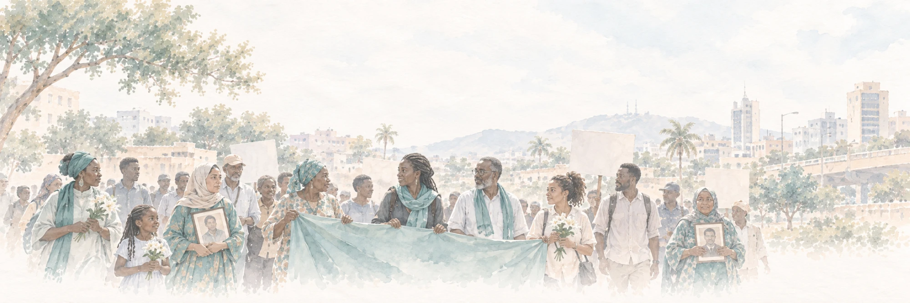

{fig-alt="Watercolour illustration of a peaceful march: women, men, and children walk together through a city, carrying a long cloth banner, white flowers, and framed portraits of lost relatives." width="100%"}

::: {.grid .text-center .my-4}

::: {.g-col-6 .g-col-md-3}
[]{.text-success}\
**Funder**\
Swedish Research Council
:::

::: {.g-col-6 .g-col-md-3}
[]{.text-success}\
**Project period**\
2027–2029
:::

::: {.g-col-6 .g-col-md-3}
[]{.text-success}\
**Funding**\
SEK 4.7 million
:::

::: {.g-col-6 .g-col-md-3}
[]{.text-success}\
**Principal investigator**\
Kate Lonergan
:::

:::

## About the project

Victims of war and mass atrocity often step forward to demand truth, accountability, and recognition. These victim movements, social movements organized around a shared identity of victimhood, can be powerful forces in the struggle for justice, but their effectiveness varies widely. Argentina's Mothers of the Plaza de Mayo and Bosnia-Herzegovina's Mothers of Srebrenica won legal recognition, the establishment of a truth commission, and trials of perpetrators. Other movements, such as those in Timor-Leste and Côte d'Ivoire, brought war victims together in advocacy yet won few real concessions.

This project asks: **Why are some victim movements more successful than others?**

Existing research shows that victims have agency and often organize to make their voices heard. However, most of what we know comes from rich studies of single movements, and disproportionately from a few emblematic success stories. Movements that died young or made little political headway rarely inform the findings. As a result, we lack a comparative foundation for identifying the factors that help victims win concessions and the obstacles that keep survivors and their families from winning redress.

The project advances knowledge in three ways:

-   **Success on victims' own terms.** We define success as a movement's ability to realize its own stated objectives, whether these concern recognition, truth, justice, accountability, reparations, memorialization, or inclusion, rather than measuring movements against assumed universal transitional justice outcomes.
-   **New theory.** We adopt a comparative lens and translate insights from social movement research to develop and test theory about how victim movements win.
-   **New data.** We compile the first global dataset on victim movements in 1989–2025 and combine it with in-depth comparative case studies.

## Research design

The project will follow a three-phased mixed-methods approach.

**Phase I: Concepts and theory.** The project will draw on the team's familiarity with victim movements across several postwar contexts to refine the concept of victim movement success, build theory, and develop an empirically grounded codebook.

**Phase II: The Victim Movements (V-Move) dataset.** The project will compile the first global dataset on victim movements during and after armed conflict in 1989–2025. The dataset will cover countries that have experienced high-intensity armed conflict and will record each movement's stated objectives, targets, tactics, and allies, as well as the progress made toward each objective. The project will use the dataset to describe patterns and trends and to analyze the determinants of movement success.

**Phase III: Comparative case studies.** The project will use the dataset to select combinations of more and less successful movements for in-depth qualitative analysis. Drawing on original interviews collected through fieldwork, the project will use process tracing to assess why some victim movements are more successful than others.

## Team

-   **Kate Lonergan** (principal investigator), [Uppsala Centre for Holocaust and Genocide Studies](https://www.uu.se/en/centre/uppsala-centre-for-holocaust-and-genocide-studies), Uppsala University
-   [**Sebastian van Baalen**](https://www.sebastianvanbaalen.se/), [Department of Peace and Conflict Research](https://www.uu.se/en/department/peace-and-conflict-research), Uppsala University

The project is based at the Uppsala Centre for Holocaust and Genocide Studies and is funded by the [Swedish Research Council](https://www.vr.se/english.html) (Vetenskapsrådet).
